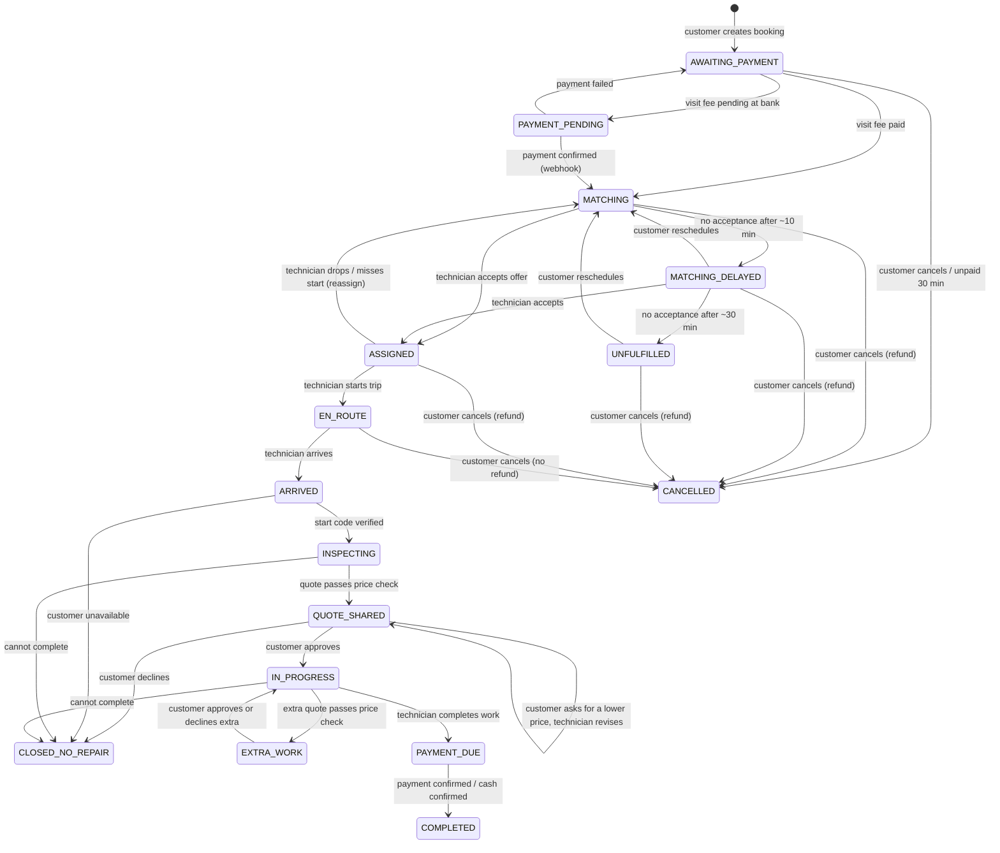

# Booking / job state machine

One booking = one job. Customers see it as a `Booking`, the assigned technician as a `Job` (same id, same `status`).
Statuses are the `BookingStatus` enum in `src/domain/types.ts`. Any transition not listed here must return `CONFLICT`.

| Status | Meaning | Who moves it next | Timeout / automatic action |
| --- | --- | --- | --- |
| `AWAITING_PAYMENT` | Booking created, ₹49 not paid. | Customer pays or cancels. | Auto-cancel after 30 min unpaid; release the slot. |
| `PAYMENT_PENDING` | Bank has not confirmed the visit fee. | Payment webhook. | Poll Razorpay after 10 min; failed → back to `AWAITING_PAYMENT`. |
| `MATCHING` | **Confirmed.** Offering to technicians one at a time. | Dispatcher, technician (accept/reject). | Each offer 45 s. → `MATCHING_DELAYED` after ~10 min. |
| `MATCHING_DELAYED` | Still searching (customer is told). | Dispatcher, customer (wait/reschedule/cancel). | → `UNFULFILLED` after ~30 min total. |
| `UNFULFILLED` | Nobody available. | Customer reschedules or cancels (full refund). | Auto-refund and cancel after 24 h if no action. |
| `ASSIGNED` | Technician accepted (`technician` set). | Technician starts trip; customer may cancel (refund). | Instant: no trip start within 10 min → reassign. Scheduled: by window start − 30 min → reassign. Reminder to technician at −60 min. |
| `EN_ROUTE` | Technician travelling (`etaMin`). | Technician arrives. Customer may cancel (no refund). | Alert support if `etaMin` exceeded by 30 min. |
| `ARRIVED` | At the door; customer tells the 4-digit code. | Technician enters code; or reports customer unavailable. | 5 wrong codes → locked, support ticket. |
| `INSPECTING` | Technician checking, preparing quote. A quote may exist with `review.state` `CHECKING`/`UNDER_REVIEW`. | Technician sends quote; price check. | `UNDER_REVIEW` auto-clears after 2 min until reviewers exist (logged). |
| `QUOTE_SHARED` | Customer sees the quote. `decision` `PENDING` or `REVISION_REQUESTED`. | Customer answers; technician revises. | Remind customer after 5 min; after 30 min the technician may close as `CUSTOMER_DECLINED`. |
| `IN_PROGRESS` | Repair approved. `workStarted` false until the technician taps Start repair. | Technician completes / adds extra quote. | |
| `EXTRA_WORK` | Extra quote visible, waiting for customer. | Customer answers. | |
| `PAYMENT_DUE` | Bill = approved quote + approved extra. `finalPayment` DUE/PENDING/FAILED; CASH waits for the technician. | Customer pays; technician confirms cash. | Remind; after 24 h unpaid → support ticket. |
| `COMPLETED` | Paid. Earnings written to the ledger. Rating allowed. | Customer rates (optional). | Rating reminder after 2 h. |
| `CLOSED_NO_REPAIR` | Visit ended without repair (`closeReason`). Visit fee kept, technician gets the visit share. Rating allowed. | — | |
| `CANCELLED` | `cancelReason` set. Visit fee `REFUNDED` if cancelled before `EN_ROUTE`. | — | |

## Offers (`job_offers`)

`OPEN` → `ACCEPTED` | `REJECTED` | `EXPIRED` (45 s) | `WITHDRAWN` (customer cancelled or another technician got it).
Only one `OPEN` offer per booking and per technician at a time. Accepting checks, in one transaction with a row lock on the booking: offer still `OPEN`, not expired, booking still `MATCHING`/`MATCHING_DELAYED`, technician has no other active job. Otherwise `OFFER_EXPIRED`.
Every channel (app, IVR call, coordinator) accepts through this same transaction. A phone call being placed, ringing or
answered never accepts an offer; only a keypad "accept" does (proposed IVR rules: `TELEPHONY-DISPATCH.md`).

## Quotes

`review.state`: `CHECKING` → `FAIR` | `UNDER_REVIEW` → `CLEARED`. The customer only sees `FAIR`/`CLEARED`.
`decision`: `PENDING` → `APPROVED` | `REVISION_REQUESTED` (MAIN only; technician then submits `version + 1`) | `REJECTED`.
A new version replaces the visible quote; keep old versions for audit.

## Payments

`DUE` → `PROCESSING` → `PAID` | `PENDING` (→ `PAID`/`FAILED`) | `FAILED` (retry allowed) → `REFUNDED` (visit fee only).
Cash: final bill only; `PENDING` with `method = CASH` until the technician confirms.

## Who may do what

| Action | Allowed statuses | Actor |
| --- | --- | --- |
| pay VISIT | `AWAITING_PAYMENT` | customer |
| cancel | `AWAITING_PAYMENT`, `MATCHING`, `MATCHING_DELAYED`, `UNFULFILLED`, `ASSIGNED`, `EN_ROUTE` | customer (coordinator later) |
| reschedule | `MATCHING_DELAYED`, `UNFULFILLED`, `ASSIGNED` | customer |
| accept / reject offer | `MATCHING`, `MATCHING_DELAYED` (offer `OPEN`) | offered technician |
| start-trip | `ASSIGNED` | assigned technician |
| arrived | `EN_ROUTE` | assigned technician |
| verify-start-code | `ARRIVED` | assigned technician |
| submit MAIN quote | `INSPECTING`, or `QUOTE_SHARED` with `REVISION_REQUESTED` | assigned technician |
| answer MAIN quote | `QUOTE_SHARED` with `PENDING` | customer |
| start-work | `IN_PROGRESS` with `workStarted = false` | assigned technician |
| submit EXTRA quote | `IN_PROGRESS` with `workStarted = true`, no pending extra | assigned technician |
| answer EXTRA quote | `EXTRA_WORK` | customer |
| complete | `IN_PROGRESS` with `workStarted = true` | assigned technician |
| pay FINAL | `PAYMENT_DUE` | customer |
| confirm-cash | `PAYMENT_DUE` with cash `PENDING` | assigned technician |
| report CUSTOMER_UNAVAILABLE | `ARRIVED` | assigned technician |
| report CANNOT_COMPLETE | `INSPECTING`, `QUOTE_SHARED`, `IN_PROGRESS` | assigned technician |
| report other issues | any active status | assigned technician |
| rate | `COMPLETED`, `CLOSED_NO_REPAIR` (once) | customer |
